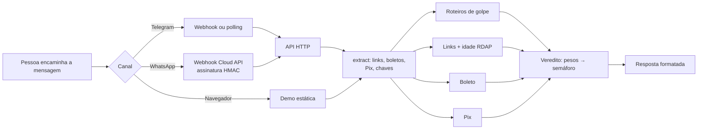

# 🛑 É Golpe?

**Detector de golpes para quem recebe mensagem suspeita no WhatsApp ou no Telegram.**
A pessoa encaminha o link, o boleto, o Pix copia e cola ou o pedido de dinheiro estranho, e o bot responde em segundos com um semáforo (🟢 🟡 🔴), os motivos e o que fazer.

[**Testar a demo**](https://henriqueribeiroleonardo1.github.io/e-golpe/) · roda 100% no navegador, nada sai do seu computador

```
🔴 Alto risco de golpe

Por quê:
• Troca de número seguida de pedido de dinheiro: é o golpe do falso parente
• Diz que trocou de número
• Pede dinheiro, Pix ou transferência
• Pede para manter segredo

O que fazer: Ligue para a pessoa no número antigo, ou faça uma pergunta
que só ela saberia, antes de qualquer Pix.
```

## A página

A landing em [`public/`](public/) roda o motor no navegador, tem um **acervo de golpes documentados** ([`acervo.ts`](src/web/acervo.ts)) com busca, filtros por categoria e canal e um botão que manda cada exemplo para o detector, e traz os números do estelionato no Brasil em planilhas com abas (por ano, por estado, modalidades, prejuízo e punição), gráficos em SVG desenhados em escala e cópia em CSV. Fontes: Anuário Brasileiro de Segurança Pública 2026 (FBSP) e Febraban.

## Destaques técnicos

- **TypeScript estrito** (`strict`, `noUncheckedIndexedAccess`, `exactOptionalPropertyTypes`).
- **Zero dependências de runtime.** HTTP, criptografia, testes e leitura de `.env` vêm do próprio Node 22.
- **Motor puro e testável.** A análise não sabe nada de HTTP nem de chat. A consulta externa (idade do domínio) entra por injeção de dependência, então os testes rodam offline.
- **Regras declarativas.** Ensinar um golpe novo é adicionar um objeto em [`scam-scripts.ts`](src/core/data/scam-scripts.ts) e um teste.
- **Validação de verdade, não só palavra-chave:** dígitos verificadores de boleto (FEBRABAN, módulos 10 e 11, incluindo a virada do fator de vencimento em 2025), leitura do Pix copia e cola (EMV com CRC16), CPF e CNPJ, e domínio registrável para detectar marca imitada.
- **Segurança nos webhooks:** assinatura HMAC-SHA256 do WhatsApp, segredo do Telegram, comparação em tempo constante, limite de requisições por IP, limite de tamanho de corpo e proteção contra _path traversal_ nos arquivos estáticos.
- **Privacidade por padrão:** o servidor nunca registra o conteúdo das mensagens, só rota, status e tempo. CPF aparece mascarado na resposta.
- **Portável.** O app é escrito sobre `Request`/`Response` da Web, então roda em Node, Bun, Deno ou Cloudflare Workers trocando só o arquivo de entrada.
- **65 testes** com `node:test`, com exemplos gerados por uma implementação independente para não validar o código contra ele mesmo.

## Como funciona



| O que checa           | Como                                                                                                                                                                                                                                                                                                                                                                                                                                                                                                                           |
| --------------------- | ------------------------------------------------------------------------------------------------------------------------------------------------------------------------------------------------------------------------------------------------------------------------------------------------------------------------------------------------------------------------------------------------------------------------------------------------------------------------------------------------------------------------------------------------ |
| **Roteiros de golpe** | 23 regras e 2 combinações sobre o texto normalizado: falso parente, falsa central do banco, conta de segurança, código por SMS, pedido de senha, taxa de encomenda, prêmio, trabalho fácil, ameaça de dívida, lucro garantido, troca de conta, boleto "atualizado", comprador que paga a mais, atualização cadastral, pagamento fora da plataforma, empréstimo com taxa antecipada, cobrança DDA, cobrança não solicitada, motoboy que busca o cartão e leilão falso. Os testes garantem que todo caso do acervo é sinalizado. |
| **Links**             | Nome de 25 marcas em domínio que não é delas (`itau-seguranca.com`), letras trocadas e números no lugar de letras (`nubamk`, `n1bank`), encurtadores, IP, punycode, `@` escondendo o host, hospedagem gratuita, extensões baratas, falta de https e idade do domínio via RDAP.                                                                                                                                                                                                                                                 |
| **Boletos**           | Valida a linha digitável bancária (47 dígitos) e de contas de consumo (48 dígitos). Mostra banco emissor, valor e vencimento. Pega boleto adulterado.                                                                                                                                                                                                                                                                                                                                                                          |
| **Pix**               | Lê o copia e cola, confere o CRC16 e avisa quando a mensagem cita uma marca mas o recebedor é outra pessoa. Desconfia de "empresa" com chave de CPF ou celular.                                                                                                                                                                                                                                                                                                                                                                |

O veredito soma o peso de cada sinal (baixo 10, médio 20, alto 35, crítico 60, confiável −25). Qualquer sinal crítico ou nota a partir de 50 vira 🔴, a partir de 20 vira 🟡. O 🟢 nunca diz "é seguro", só "não encontrei sinais de golpe".

## Estrutura

```
src/
  core/            motor de análise (sem I/O, roda no navegador)
    analyzers/     script, links, boleto, pix
    data/          regras de golpe, marcas, bancos
    extract.ts     separa a mensagem em partes verificáveis
    verdict.ts     pesos → semáforo
    format.ts      resposta para WhatsApp e Telegram
    domain-age.ts  idade do domínio via RDAP (com cache e timeout)
  lib/             boleto, Pix BR Code, CPF/CNPJ, domínio, HMAC, rate limit
  channels/        Telegram e WhatsApp
  http/            app Web-standard + adaptador para Node
  server.ts        servidor de produção
  telegram-polling.ts  bot no seu computador, sem servidor público
public/            landing + demo + planilhas do 171 (GitHub Pages)
test/              testes com node:test
```

## Rodando

Requer Node 22 ou mais novo.

```bash
npm install
npm test          # 65 testes
npm run dev       # API + demo em http://localhost:3000
```

Testar a API:

```bash
curl -X POST localhost:3000/api/analyze \
  -H 'content-type: application/json' \
  -d '{"text":"Sua encomenda está retida, pague a taxa em correios-taxa.com"}'
```

### Bot do Telegram no seu computador (grátis)

1. No Telegram, fale com o [@BotFather](https://t.me/BotFather), mande `/newbot` e copie o token.
2. `cp .env.example .env` e cole o token em `TELEGRAM_BOT_TOKEN`.
3. `npm run bot` e mande uma mensagem para o seu bot.

## Deploy gratuito

| Peça             | Onde                                                      | Custo                            |
| ---------------- | --------------------------------------------------------- | -------------------------------- |
| Demo             | GitHub Pages (workflow incluso)                           | grátis                           |
| API + webhooks   | Render, plano free ([`render.yaml`](render.yaml) incluso) | grátis, "dorme" após inatividade |
| Bot              | Telegram Bot API                                          | grátis                           |
| Idade do domínio | RDAP público (Registro.br e rdap.org)                     | grátis, sem chave                |

**Demo:** em _Settings → Pages_, escolha "GitHub Actions". Cada push na `main` publica a pasta `public/`.

**API no Render:** crie um _Blueprint_ apontando para o repositório e preencha as variáveis. Depois registre o webhook do Telegram:

```bash
curl "https://api.telegram.org/bot$TELEGRAM_BOT_TOKEN/setWebhook" \
  -d "url=https://SEU-APP.onrender.com/webhooks/telegram" \
  -d "secret_token=$TELEGRAM_WEBHOOK_SECRET"
```

**WhatsApp (opcional):** a integração com a WhatsApp Cloud API está pronta em [`whatsapp.ts`](src/channels/whatsapp.ts). Ela exige um app no Meta for Developers, que oferece número de teste. Respostas a conversas iniciadas pelo usuário dentro da janela de 24h não são cobradas pela Meta hoje, mas confira a tabela de preços atual antes de abrir para o público.

## Variáveis de ambiente

| Variável                                                                                     | Para quê                                                        |
| -------------------------------------------------------------------------------------------- | --------------------------------------------------------------- |
| `PORT`                                                                                       | Porta HTTP (padrão 3000)                                        |
| `DOMAIN_AGE_LOOKUP`                                                                          | `off` desliga a consulta RDAP                                   |
| `TELEGRAM_BOT_TOKEN`                                                                         | Liga o bot do Telegram                                          |
| `TELEGRAM_WEBHOOK_SECRET`                                                                    | Obrigatório para o webhook. Sem ele, só o modo polling funciona |
| `WHATSAPP_TOKEN`, `WHATSAPP_PHONE_NUMBER_ID`, `WHATSAPP_VERIFY_TOKEN`, `WHATSAPP_APP_SECRET` | Ligam o WhatsApp (todas juntas)                                 |
| `WHATSAPP_GRAPH_VERSION`                                                                     | Versão da Graph API (padrão `v23.0`)                            |

## Próximos passos

- Ler prints com OCR (Tesseract.js) e áudios com transcrição local.
- Modo Família: avisar um parente quando alguém da família recebe um 🔴.
- Base colaborativa de chaves Pix e domínios denunciados.

## Aviso

O É Golpe? é uma ferramenta de apoio. Ele não garante que uma mensagem é segura e não substitui o banco nem a polícia. Em caso de golpe, avise o seu banco pelos canais oficiais e registre um boletim de ocorrência.

## Licença

MIT © Henrique Ribeiro Leonardo
